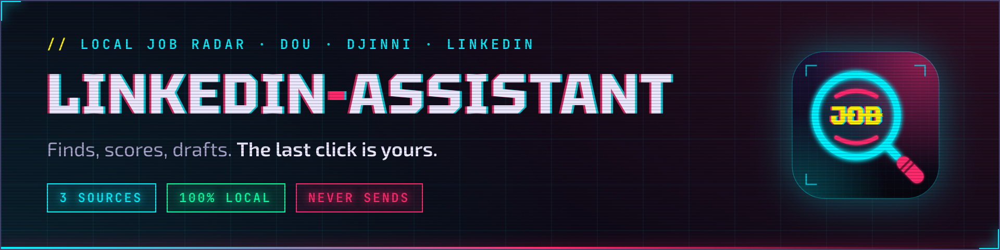
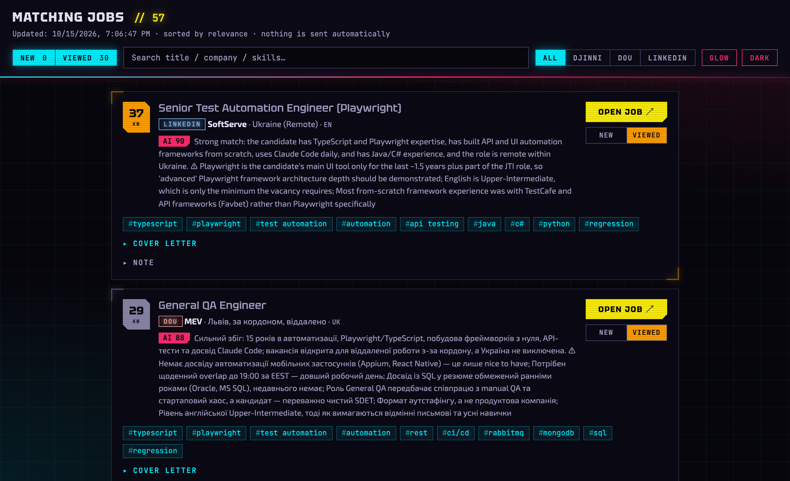

<div align="center">



<br>

[](docs/job-discovery.md)
[](#key-principles)
[](#key-principles)
[](docs/setup.md#schedule-it-launchd)
[](#quick-start)
[](LICENSE)

`//` [What it does](#what-it-does) · [Quick start](#quick-start) · [Docs](#documentation) · [Discovery](docs/job-discovery.md) · [Dashboard](docs/dashboard.md) · [Adapt it](docs/specialization.md) `//`

</div>

> 🇺🇦 [Українською](README.uk.md)

Your netrunner on the job market. It runs quietly on your Mac: watches recruiter
messages in your LinkedIn inbox, sweeps DOU, Djinni and LinkedIn for vacancies,
measures each one against your resume, and prepares ready-to-review
reply/application drafts. **It never sends anything** — the final click is
always yours.



> ⚠️ **Corpo rules.** LinkedIn's User Agreement restricts automated access. This
> tool only *reads* your own inbox and *drafts* replies for you — it does not
> auto-message or scrape others. Run it modestly. Use at your own discretion;
> LinkedIn can still flag automation.

## What it does

**`01` Inbox** — reads unread LinkedIn messages, scores each against your skill
profile and drafts a reply in the sender's language (🇺🇦/🇷🇺/🇬🇧), flagging when
to attach your resume. Unread Djinni threads light up the same Dock badge.

**`02` Job discovery** — pulls new vacancies from DOU (RSS), Djinni (public
board) and LinkedIn Jobs (search, can be turned off), collapses the same vacancy
posted on several boards, and drops jobs located abroad. Each vacancy passes two
gates: a keyword score from your profile (≥ 18 and a matching role), then a
local `claude -p` fit score against your resume (≥ 70). A match becomes an
application package: tailored cover letter, link and resume path.

<details>
<summary>How a vacancy is scored, gate by gate, with worked examples</summary>

<picture>
  <source media="(prefers-color-scheme: dark)" srcset="docs/scoring-dark.png">
  
</picture>

</details>

**`03` Dashboard** — every package on one local page in a neon Night City skin
(light and dark themes), sorted by relevance, with New/Viewed tabs, private
notes, search and a source filter. Vacancies the board closes are marked Closed
by a daily check.

**`04` Runs on its own** — launchd agents check the inboxes and DOU/Djinni
hourly and LinkedIn every 3 hours. A run posts one macOS banner, and only when
it found something or something broke. Optionally the same alerts reach your
phone through your own Telegram bot, each with a link to the vacancy or thread
([setup](docs/setup.md#phone-alerts-telegram-optional)).

## Key principles
- 🔒 **Security:** your password is never stored (you log in once yourself), everything is local; no API keys at all (the optional Telegram alerts are the one exception: their text goes to your own bot)
- 🚫 **No auto-send:** the scripts only prepare — you review and apply manually
- ⚖️ **Minimal risk:** DOU via legal RSS, LinkedIn scraping modest and toggleable

## Quick start

macOS and Node.js 20+. Jacking in takes eight lines:

```bash
git clone https://github.com/lzb150/linkedin-assistant.git ~/linkedin-assistant
cd ~/linkedin-assistant
npm install && npx playwright install chromium
cp ~/path/to/your-resume.txt resume.txt   # plain text
node make-skills.mjs                      # skills.json: what to look for
$EDITOR jobs.config.json                  # where to look, and your country
node login.mjs                            # log in yourself once; the password is never stored
node jobs.mjs && node dashboard.mjs --open
```

Then put it on a schedule: [docs/setup.md](docs/setup.md).

## Documentation

| Page | What's in it |
|------|--------------|
| [Setup](docs/setup.md) | Install, first run, launchd agents, LinkedIn on a sleeping Mac |
| [Inbox assistant](docs/inbox.md) | `check.mjs`, reply drafts, Dock badge, Djinni inbox and profile auto-bump |
| [Job discovery](docs/job-discovery.md) | Sources, filters, both gates, LLM hardening, source health, `skills.json` |
| [Dashboard](docs/dashboard.md) | State server, statuses, filters, closed-vacancy check, weekly report |
| [Your specialization](docs/specialization.md) | Retarget it from QA to any profession |
| [When it breaks](docs/troubleshooting.md) | Selectors, expired session, missing Chromium, slow runs |
| [Project layout](docs/project-layout.md) | Which file does what |

## Contributing
Issues and pull requests are welcome. `main` is protected: changes land only
through a PR with an approving review from the repository owner — fork, open a
PR, and it will be reviewed.

## Technologies
JavaScript (Node.js) · Playwright · DOU RSS · launchd · Swift/AppKit (neon Dock
icon) · no external dependencies beyond Playwright. The images in this README
are drawn from HTML in [docs/src](docs/src/render.mjs).

## License
[MIT](LICENSE)
