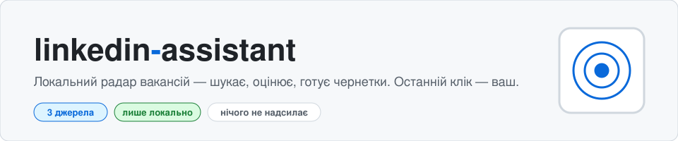

<div align="center">

<picture>
  <source media="(prefers-color-scheme: dark)" srcset="docs/banner-dark.uk.svg">
  
</picture>

<br>

[](docs/job-discovery.uk.md)
[](#ключові-принципи)
[](#ключові-принципи)
[](docs/setup.uk.md#розклад-launchd)
[](#швидкий-старт)
[](LICENSE)

[Що вміє](#що-вміє) · [Швидкий старт](#швидкий-старт) · [Документація](#документація) · [Пошук](docs/job-discovery.uk.md) · [Дашборд](docs/dashboard.uk.md) · [Інша професія](docs/specialization.uk.md)

</div>

> 🇬🇧 [English version](README.md)

Локальний помічник у пошуку роботи: стежить за повідомленнями рекрутерів у
вашій скриньці LinkedIn, шукає вакансії на DOU, Djinni та LinkedIn, оцінює їх
відповідність вашому резюме і готує чернетки відповідей та відгуків, готові до
перегляду. **Сам нічого не надсилає** — останній клік завжди за вами.


> ⚠️ Угода користувача LinkedIn обмежує автоматизований доступ. Цей інструмент
> лише *читає* вашу власну скриньку і *готує чернетки* відповідей — він не
> розсилає повідомлення і не скрейпить чужі дані. Запускайте помірно.
> Використовуйте на власний розсуд: LinkedIn усе одно може розцінити це як
> автоматизацію.

## Що вміє

**Скринька** — читає непрочитані повідомлення LinkedIn, оцінює кожне за вашим
профілем навичок і готує чернетку відповіді мовою відправника (🇺🇦/🇷🇺/🇬🇧),
підказуючи, коли додати резюме. Непрочитані треди Djinni показуються на тому
самому бейджі в Dock.

**Пошук вакансій** — бере нові вакансії з DOU (RSS), Djinni (публічна дошка) і
LinkedIn Jobs (пошук, можна вимкнути), склеює одну вакансію з кількох дощок і
відкидає вакансії за кордоном. Кожна вакансія проходить два фільтри:
keyword-бали з вашого профілю (≥ 18 і відповідна роль), потім локальна оцінка
`claude -p` за вашим резюме (≥ 70). Збіг стає пакетом для відгуку:
супровідний лист під вакансію, посилання і шлях до резюме.

<details>
<summary>Як вакансія отримує оцінку, фільтр за фільтром, із прикладами</summary>

<picture>
  <source media="(prefers-color-scheme: dark)" srcset="docs/scoring-dark.uk.png">
  
</picture>

</details>

**Дашборд** — усі пакети на одній локальній сторінці за релевантністю, з
вкладками New/Viewed, приватними нотатками, пошуком і фільтром за джерелом.
Вакансії, які дошка закрила, щодня позначаються як Closed.

**Працює сам** — агенти launchd щогодини перевіряють скриньки та DOU/Djinni, а
LinkedIn кожні 3 години. Прогін показує один банер macOS, і лише коли щось
знайшов або щось зламалося.

## Ключові принципи
- 🔒 **Безпека:** пароль ніде не зберігається (логінитесь один раз самі), все локально; жодних API-ключів
- 🚫 **Жодної автовідправки:** скрипти лише готують — переглядаєте і відгукуєтесь ви
- ⚖️ **Мінімальний ризик:** DOU через легальний RSS, скрейпінг LinkedIn помірний і вимикається

## Швидкий старт

macOS і Node.js 20+.

```bash
git clone https://github.com/lzb150/linkedin-assistant.git ~/linkedin-assistant
cd ~/linkedin-assistant
npm install && npx playwright install chromium
cp ~/path/to/your-resume.txt resume.txt   # звичайний текст
node make-skills.mjs                      # skills.json: що шукати
$EDITOR jobs.config.json                  # де шукати і ваша країна
node login.mjs                            # логінитесь самі один раз; пароль не зберігається
node jobs.mjs && node dashboard.mjs --open
```

Далі — розклад: [docs/setup.uk.md](docs/setup.uk.md).

## Документація

| Сторінка | Що там |
|----------|--------|
| [Налаштування](docs/setup.uk.md) | Встановлення, перший запуск, агенти launchd, LinkedIn на сплячому Mac |
| [Асистент скриньки](docs/inbox.uk.md) | `check.mjs`, чернетки відповідей, бейдж у Dock, скринька Djinni й автопідняття профілю |
| [Пошук вакансій](docs/job-discovery.uk.md) | Джерела, фільтри, обидва фільтри оцінки, захист LLM, здоров'я джерел, `skills.json` |
| [Дашборд](docs/dashboard.uk.md) | Сервер стану, статуси, фільтри, перевірка закритих вакансій, тижневий звіт |
| [Ваша спеціалізація](docs/specialization.uk.md) | Як перевести з QA на будь-яку професію |
| [Коли щось ламається](docs/troubleshooting.uk.md) | Селектори, сесія, відсутній Chromium, повільні прогони |
| [Структура проєкту](docs/project-layout.uk.md) | Який файл за що відповідає |

## Внесок у проєкт
Issues та pull requests вітаються. Гілка `main` захищена: зміни потрапляють
лише через PR зі схвальним ревю власника репозиторію — зробіть fork,
відкрийте PR, і його буде розглянуто.

## Технології
JavaScript (Node.js) · Playwright · DOU RSS · launchd · Swift/AppKit (іконка) ·
жодних зовнішніх залежностей, крім Playwright.

## Ліцензія
[MIT](LICENSE)
