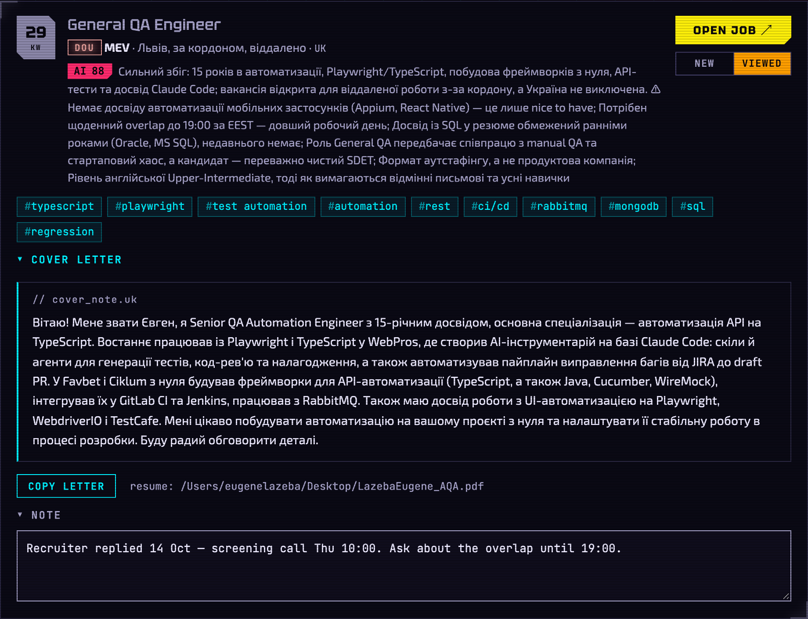
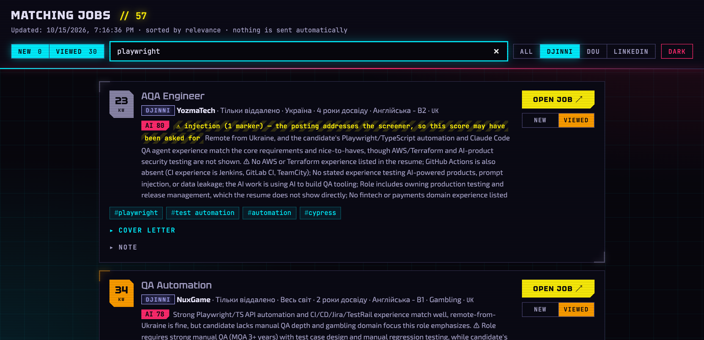
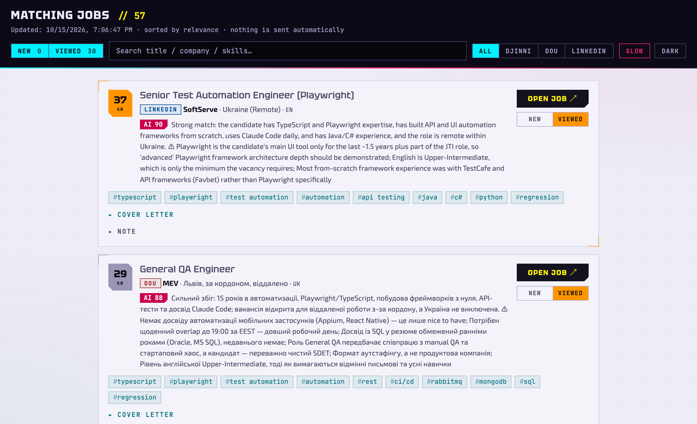

# Дашборд — `dashboard.mjs`

> **//** Частина [linkedin-assistant](../README.uk.md). Ваш HUD на ринку праці: усі пакети на одній локальній сторінці, плюс щоденна перевірка закритих вакансій і тижневий звіт.
>
> 🇬🇧 [English version](dashboard.md)

```bash
node dashboard.mjs          # перебудувати applications/index.html
node dashboard.mjs --open   # перебудувати і відкрити
```

Рендерить пакети з `applications/` як картки, відсортовані за балом. Стан
кожної картки (статус, нотатки) прив'язаний до URL вакансії і
зберігається на диску сервером стану (див. нижче), тож переживає
перегенерацію дашборда і скидання браузера. Відкриття вакансії чи розгортання
супровідного листа автоматично позначає картку як Viewed.

`applications/` лише поповнюється, тому дашборд **згортає дублікати пакетів за
ідентичністю** (`company + title`) під час рендерингу, лишаючи найсвіжіший. Ви
бачите кожну вакансію один раз, навіть якщо старі пакети лежать на диску.

### Сервер стану, статуси й фільтри

**Сервер стану (`state-server.mjs`)** замінює localStorage браузера як шар
збереження. Дашборд віддає крихітний локальний HTTP-сервер на
`http://127.0.0.1:7777/` (лише localhost, ніколи не відкривається назовні); його
тримає запущеним launchd-агент `state-server`. Клік
по іконці Jobs.app у Dock запускає `open-dashboard.sh`, який перегенерує дашборд
і відкриває браузер. Стан вакансій (статус,
нотатки, час останнього візиту) пишеться у `job-state.json` на диску, тож
переживає скидання браузера чи повне перезавантаження системи. Якщо сервер
недоступний, дашборд відкочується до `localStorage` і показує бейдж
**«offline — not saved to disk»**. Перед першим записом кожного дня сховище
знімається у `job-state.YYYY-MM-DD.bak` (зберігаються останні 7) — щоб відкотити
поганий день, скопіюйте знімок поверх `job-state.json`. Після оновлення коду
перезапустіть сервер: `launchctl kickstart -k gui/$UID/com.<you>.state-server`.
`com.<you>.…` тут — це **`Label`** з plist, а не імʼя файлу: launchctl адресує
служби за label, тож перейменування лише файлу залишить усі агенти
зареєстрованими як `com.example.…`, і ця команда не спрацює.

**Статуси** — інструмент є радаром: він знаходить і готує, а відгукуєтеся ви
вибірково, на сайті вакансії, тож дашборд стежить лише за тим, що потрібно, аби
лишатися читабельним. Картка **New**, доки ви не відкриєте вакансію чи не
розгорнете лист — тоді вона автоматично стає **Viewed**; **Closed** ставить
перевірка закритих вакансій нижче, і такі картки зникають з переглядів New і Viewed (зніміть обидві вкладки, щоб побачити все). Це вся модель — конвеєра applied/answered/interview немає (кілька справжніх відгуків
живуть у вашій поштовій скриньці, не тут). До будь-якої картки можна додати
приватну нотатку; вона зберігається на диск через сервер стану. У шапці —
New / Viewed з живими лічильниками, типово обрані обидві.



**Пошук і свіжість** — поле пошуку фільтрує картки за назвою, компанією чи
навичками; чипи джерел (All плюс по одному на кожну дошку, що має пакети на
диску) звужують список до однієї дошки. Картки, що з'явилися після вашого останнього візиту,
підсвічуються стрічкою **NEW**. Картки Viewed, яких ви не торкалися 30 днів, архівує
щоденний запуск closed-check (див. «Перевірка закритих вакансій (`closed-check.mjs`)» нижче).



**Тема** — кіберпанк-скін «Night City»: неоновий блакитний, малиновий і сигнальний
жовтий на майже чорному в темному режимі, ті самі відтінки, але глибші, у світлому.
Слідує системній світлій/темній; кнопка **Dark** закріплює одну з них (на цей
браузер). Кожна пара текст/тло ≥ 4.5:1 в обох режимах. Неонове світіння й лінії
розгортки є лише в темному режимі; `prefers-reduced-motion` зупиняє «глітч»
заголовка й пульсацію стрічки NEW.



**Перевірка закритих вакансій (`closed-check.mjs`)** — щоденне launchd-завдання
(`com.eugene.closed-check.plist`, постачається як `.example`, 08:30) опитує
вакансії DOU, Djinni і LinkedIn, що досі мають статус **New** чи **Viewed** (звичайний GET,
одна за секунду, кожна адреса не частіше ніж раз на 3 дні, 150 за запуск), і
позначає ті, які дошка називає неактивними («вакансія неактивна», публічне
«No longer accepting applications» у LinkedIn), як **Closed**.
Закриті картки зникають з переглядів New і Viewed (зі знятими вкладками видні з
приглушеною позначкою «· closed») і не відкриваються назад кліком. Закриті пакети
переносяться до `applications/archive/` після 14-денного пільгового періоду, туди ж
потрапляють Viewed-пакети, яких ви не торкалися 30 днів, і цю папку ніхто не читає.
`run.sh` видаляє архівні пакети, старші за 180 днів. Банерів не показує —
закриті вакансії видно за приглушеною позначкою «· closed» на дашборді. Встановлення
таке ж, як для тижневого звіту нижче, з `com.example.closed-check.plist.example`.

**Тижневий звіт (`report.mjs`)** — тижневий дебрифінг, одна команда, що підсумовує останні 7 днів:
запуски й нові розглянуті вакансії, пакети за джерелами, вердикти LLM
(відкинуто / збій / оцінено і найкращий збіг) та медіанний
вихід кожного джерела за запуск. `node report.mjs` друкує звіт; `--notify`
додатково показує однорядкове macOS-сповіщення — саме так працює тижневе
launchd-завдання (`com.eugene.jobs-report.plist`, постачається як `.example`,
понеділок 09:00). `REPORT_DAYS=14` розширює вікно. Лічильники LLM беруться з
логів запусків у `logs/`, тож охоплюють лише те, що ще не видалила ротація.
Встановлення:

```bash
cp com.example.jobs-report.plist.example \
   ~/Library/LaunchAgents/com.eugene.jobs-report.plist   # відредагуйте шляхи всередині
launchctl load ~/Library/LaunchAgents/com.eugene.jobs-report.plist
```
