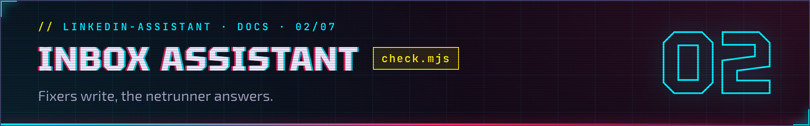

<h1></h1>

> **//** Part of [linkedin-assistant](../README.md). Fixers write, the netrunner answers: reply drafts for LinkedIn recruiter messages, and one Dock badge for LinkedIn and Djinni unread.
>
> 🇺🇦 [Українською](inbox.uk.md)

## LinkedIn inbox — `check.mjs`

```bash
node check.mjs              # headless; UNREAD threads only (LinkedIn's ?filter=unread list)
HEADFUL=1 node check.mjs    # watch it (useful when selectors break)
MAX=5 node check.mjs        # cap unread threads opened this run
SCAN_ALL=1 node check.mjs   # scan recent threads regardless of read state; leaves the Dock badge alone
```

New drafts land in `drafts/`. Each draft is a markdown file: their message, a
suggested reply, the relevance score, and an attach-resume checkbox. It never
clicks Send.


### Unread badge on the Jobs app

Each scan writes the LinkedIn badge state to `notify-state.json`. The
**Jobs app** (`Jobs.app`, the neon magnifier icon) runs persistently in the Dock and reads that file
every few seconds, showing the count as a red Dock badge.
Every new unread LinkedIn message posts a banner (`<name>: <message start>`) and
**keeps the badge until you click the Jobs icon**: the scan opens the thread,
which marks it read, so a plain unread count would drop it on the next hourly
run — easy to miss when you are away. The bannered threads are kept in
`notify-state.json`'s `pending` list. While the badge is up (and Djinni has
nothing unread), clicking the Dock icon or a banner opens that thread (several:
the inbox) and clears the LinkedIn badge on the spot — the next scan brings it
back only for something new or still unread (a thread you marked unread in
LinkedIn stays on the badge, without a new banner). With no unread anywhere the click
opens the dashboard as before.
All macOS banners are posted by this app too (queued as `banners/*.json` by
`lib/notify.mjs`), so they carry its icon, and clicking one acts like a Dock-icon
click (above): the Djinni conversation, the LinkedIn thread, or the dashboard.
Without a built `Jobs.app` they fall back to `osascript` (Script Editor icon).

Build it with `./build-jobs.sh`, then start it at login by installing
`com.example.jobs-badge.plist.example` as `com.example.jobs-badge.plist` into
`~/Library/LaunchAgents/` (replace `YOUR_USERNAME` inside first — with a wrong
path launchd respawns `open` every 10 s forever). `check.mjs` also relaunches it
defensively on each scan. The agent leaves a running app alone (`open` on it would
act as a Dock click), so `launchctl kickstart -k` or unload restarts only the agent;
stop the app itself with `pkill -f Jobs.app/Contents/MacOS/jobs` (launchd starts
it again within 10 s).

## Djinni inbox (combined Dock badge)

The Dock badge on `Jobs.app` shows the **combined** number of unread message threads from **LinkedIn** and **Djinni** — one HUD counter for every fixer who wrote.

One-time login (whenever the Djinni session expires):

```bash
node login.mjs djinni   # opens a browser; log in to Djinni manually (incl. 2FA)
```

Count unread Djinni inbox threads (writes `djinni-notify-state.json`):

```bash
node djinni-check.mjs              # headless
HEADFUL=1 node djinni-check.mjs    # watch it / fix selectors against the live page
```

Clicking the badge or a Djinni banner opens the unread thread (or the unread bucket) **and clears the Djinni badge on the spot** — the next hourly scan brings it back only if something is still unread. `djinni-check.mjs` is **count-only** for the inbox: it counts the conversation threads in Djinni's unread bucket (`https://djinni.co/my/inbox?bucket=unread`), never opens threads, never drafts, never sends. `Jobs.app` polls both `notify-state.json` (LinkedIn) and `djinni-notify-state.json` (Djinni) every ~3 s and badges their sum.

**Auto-bump:** the same run also keeps your profile fresh — Djinni lets you "Bump My Profile" (raise it in recruiter search results) periodically (every 7 days, as observed; the button itself says when). Once a day (hourly around the expected end of the cooldown) the script checks the button on `djinni.co/my/profile/` and clicks it whenever it is enabled — the button's own state is the source of truth, so any bump frequency Djinni allows is picked up automatically. Confirms the modal and fires a "Profile bumped" banner. Throttle state lives in `djinni-bump-state.json` (gitignored); a bump failure never affects the unread scan.

Run it hourly via launchd:

```bash
cp com.example.djinni-inbox.plist.example \
   ~/Library/LaunchAgents/com.eugene.djinni-inbox.plist      # then edit the paths
launchctl load ~/Library/LaunchAgents/com.eugene.djinni-inbox.plist
```
