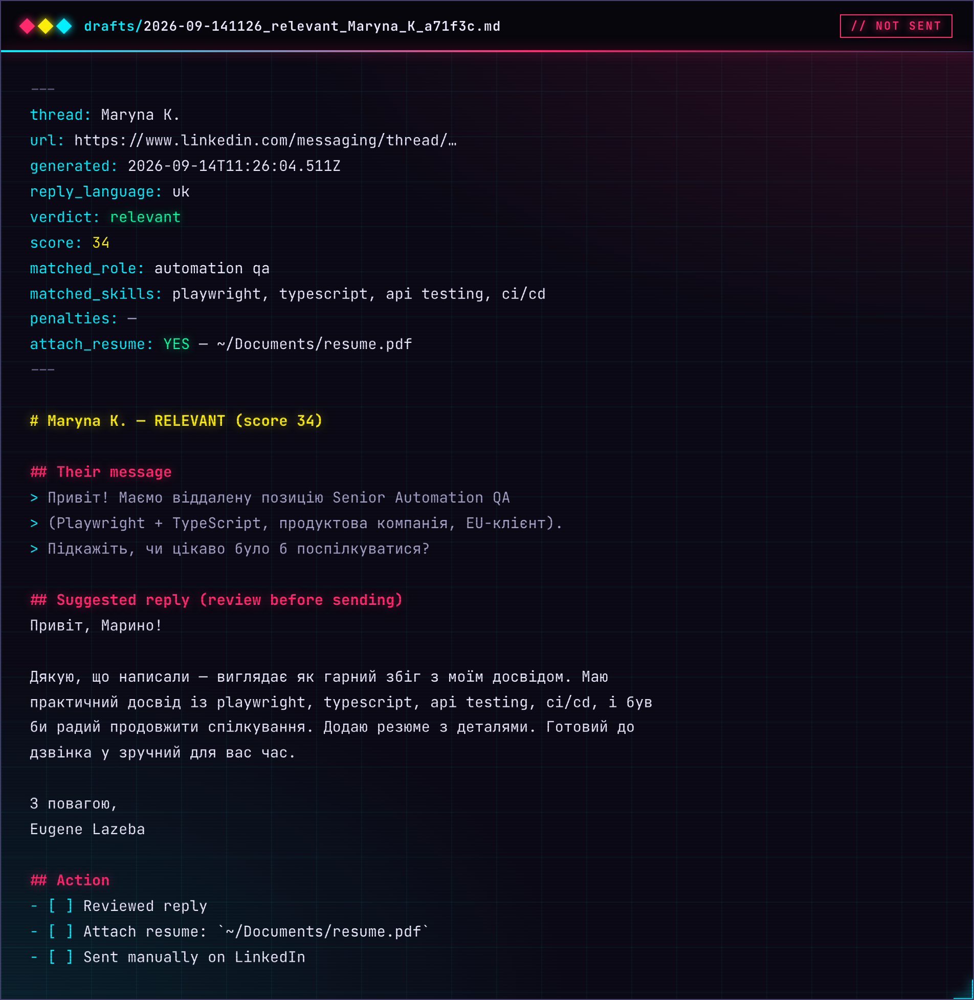

# Асистент скриньки

> Частина [linkedin-assistant](../README.uk.md). Чернетки відповідей на повідомлення рекрутерів у LinkedIn і один бейдж у Dock для непрочитаного з LinkedIn і Djinni.
>
> 🇬🇧 [English version](inbox.md)

## Скринька LinkedIn — `check.mjs`

```bash
node check.mjs              # headless; лише НЕПРОЧИТАНІ треди (список LinkedIn ?filter=unread)
HEADFUL=1 node check.mjs    # дивитись наживо (корисно, коли зламались селектори)
MAX=5 node check.mjs        # обмежити кількість відкритих тредів за запуск
SCAN_ALL=1 node check.mjs   # сканувати останні треди незалежно від статусу прочитання; бейдж у Dock не чіпає
```

Нові чернетки з'являються у `drafts/`. Кожна чернетка — markdown-файл: їхнє
повідомлення, запропонована відповідь, бал релевантності та чекбокс «прикріпити
резюме». Кнопку «Надіслати» він не натискає ніколи.



### Бейдж непрочитаного на застосунку Jobs

Кожне сканування записує стан LinkedIn-бейджа у `notify-state.json`.
**Застосунок Jobs** (`Jobs.app`) постійно працює в Dock, читає цей файл кожні
кілька секунд і показує кількість червоним бейджем на іконці.
Кожне нове непрочитане повідомлення LinkedIn показує банер (`<ім'я>: <початок повідомлення>`)
і **тримає бейдж, доки ви не клікнете іконку Jobs**: сканування відкриває тред і
цим позначає його прочитаним, тож проста кількість непрочитаних зникла б уже на
наступному щогодинному прогоні — легко пропустити, коли вас немає за комп'ютером.
Такі треди зберігаються у списку `pending` у `notify-state.json`. Поки бейдж горить
(а на Djinni непрочитаного немає), клік по іконці в Dock чи по банеру відкриває
цей тред (кілька — скриньку) й одразу гасить LinkedIn-бейдж — наступне сканування
поверне його лише для нового чи досі непрочитаного (тред, який ви позначили
непрочитаним у LinkedIn, лишається на бейджі, без нового банера). Коли непрочитаного немає ніде,
клік відкриває дашборд, як і раніше.

Зберіть його через `./build-jobs.sh`, потім увімкніть автозапуск при вході,
встановивши `com.example.jobs-badge.plist.example` як `com.example.jobs-badge.plist`
у `~/Library/LaunchAgents/` (спершу замініть `YOUR_USERNAME` усередині — з хибним
шляхом launchd перезапускатиме `open` кожні 10 с без кінця). `check.mjs` також
перезапускає його про всяк випадок при кожному скануванні.
Усі macOS-банери також показує цей застосунок (черга `banners/*.json` від
`lib/notify.mjs`), тож вони мають його іконку, а клік працює як клік по іконці
в Dock (вище): розмова Djinni, тред LinkedIn або дашборд. Без
зібраного `Jobs.app` — fallback на `osascript` (іконка Script Editor).

## Скринька Djinni (спільний бейдж у Dock)

Бейдж на `Jobs.app` показує **сумарну** кількість непрочитаних
тредів з **LinkedIn** та **Djinni**.

Одноразовий логін (щоразу, коли сесія Djinni закінчується):

```bash
node login.mjs djinni   # відкриває браузер; залогіньтесь на Djinni вручну (разом із 2FA)
```

Підрахунок непрочитаних тредів скриньки Djinni (пише у `djinni-notify-state.json`):

```bash
node djinni-check.mjs              # headless
HEADFUL=1 node djinni-check.mjs    # дивитись наживо / лагодити селектори на живій сторінці
```

Клік по бейджу чи Djinni-банеру відкриває непрочитаний тред (або теку непрочитаного) **і одразу гасить Djinni-бейдж** — наступний щогодинний скан поверне його, лише якщо щось досі непрочитане. `djinni-check.mjs` **лише рахує**: він підраховує треди у теці непрочитаного
Djinni (`https://djinni.co/my/inbox?bucket=unread`), ніколи не відкриває треди,
не готує чернеток і нічого не надсилає. `Jobs.app` опитує обидва файли —
`notify-state.json` (LinkedIn) і `djinni-notify-state.json` (Djinni) — кожні
~3 с і показує їхню суму.

**Автобамп:** той самий запуск підтримує профіль свіжим — Djinni дозволяє «Bump My Profile» (підняти профіль у результатах пошуку рекрутерів) періодично (кожні 7 днів, як спостережено; кнопка сама каже, коли можна). Раз на день (щогодини близько очікуваного кінця кулдауну) скрипт перевіряє кнопку на `djinni.co/my/profile/` і натискає її, щойно вона активна — стан кнопки є джерелом істини, тож будь-яка частота, яку дозволяє Djinni, підхоплюється автоматично. Підтверджує модальне вікно й показує банер «Profile bumped». Стан тротлінгу лежить у `djinni-bump-state.json` (у .gitignore); збій бампу ніколи не впливає на сканування непрочитаного.

Запуск щогодини через launchd:

```bash
cp com.example.djinni-inbox.plist.example \
   ~/Library/LaunchAgents/com.eugene.djinni-inbox.plist      # потім відредагуйте шляхи
launchctl load ~/Library/LaunchAgents/com.eugene.djinni-inbox.plist
```
