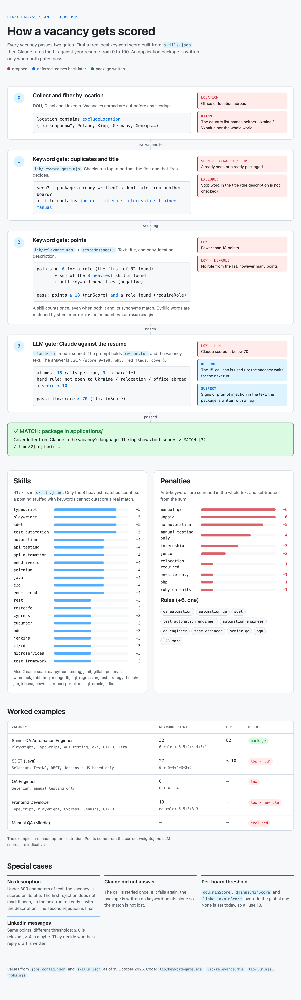

<h1></h1>

> **//** Part of [linkedin-assistant](../README.md). The radar's scanner: how vacancies are found, scored and packaged.
>
> 🇺🇦 [Українською](job-discovery.uk.md)

Sweeps the boards for *new* vacancies (gigs, in Night City terms), scores them
against your resume, and writes an
**application package** (cover letter in the job's language + resume path) for
each strong match into `applications/`. **It never submits anything.**

```bash
node jobs.mjs              # all sources (per jobs.config.json)
DOU_ONLY=1 node jobs.mjs   # skip LinkedIn scraping (DOU, Djinni, Himalayas and Telegram still run — fully ToS-clean)
HEADFUL=1 node jobs.mjs    # visible Chrome window (watch the LinkedIn part)
```

Scheduled runs are headless — no browser window. Boards that Cloudflare blocks
in headless Chrome (Work.ua, Robota.ua, Glassdoor) and Jooble's snippet-only API
were dropped in Sep 2026; git history has the source modules if you want them
back with a visible browser.

- **DOU** — official RSS feeds (`jobs.dou.ua`), clean and structured. Edit feeds in `jobs.config.json`.
- **Djinni** — public jobs board (`djinni.co/jobs/`), read with a plain fetch (no login, no browser). Each search is a full jobs-search URL — copy them from your browser's filters. On only with `djinni.enabled: true` (as shipped). `pages` (default 3) is how many pages of 15 each search reads — Djinni does not list newest-first; `concurrency` (default 5) caps the parallel detail-page fetches; `fullDescription: false` scores on the listing snippet only.
- **Himalayas** — remote-jobs board (`himalayas.app`) for foreign employers, read through its free public JSON API (no key, no login, no browser). Each search is a free-text query (`"SDET"`, `"QA automation"`); the API itself keeps only jobs open to the first `candidateCountry` entry (put the English name first) or to the whole world, newest first. On only with `himalayas.enabled: true` (as shipped). `pages` (default 2) is how many pages of up to 20 each search reads. `worldwide: false` (as shipped) keeps only jobs that name the candidate's country itself and drops the ones open to the whole world, which draw applicants from everywhere; the default `true` keeps both. Its job pages sit behind Cloudflare, so the daily closed check skips them; a viewed card still moves to the archive after 30 days untouched.
- **Telegram channels** — public job channels (`@remote_qa_jobs` ships) read through Telegram's web preview `t.me/s/<channel>` (no login, no bot, no browser). Only channels have a preview — a group is logged as `not a public channel preview` and skipped. Posts must use the "Field: value" template `@remote_qa_jobs` uses (`Title`, `Company name`, `Location`, `Anywhere`, …); a post without a `Title` (an ad) is skipped. The post's `Location` / `Anywhere` fields decide eligibility; the job pages' own country data is not used, as it often names the employer's office. A `Forbidden locations` list that names the candidate's country drops the post (the channel's usual "Outside Europe and Ukraine" is a list of where you may live, not a ban). The post's description is a short summary, so for each new job the apply link is fetched and its JSON-LD description added (`fullDescription: false` turns that off); only public https links are followed. On only with `tgchannels.enabled: true` (as shipped). `pages` (default 1) is how many pages of ~20 posts each channel reads. `worldwide: false` (as shipped) keeps only posts whose `Location` names the candidate's country, as for Himalayas. The apply links point at dozens of boards, so the daily closed check skips these jobs — except a link to DOU, Djinni or LinkedIn, which is checked as that board; a viewed card still moves to the archive after 30 days untouched. Unrelated to `telegram.json`, which sends your own alerts.
- **LinkedIn Jobs** — scrapes search results (⚠️ ToS-restricted, more detectable). On only with `linkedin.enabled: true` (as shipped). DOU is the one source that is on unless `dou.enabled: false`.
- **Title filter** — titles containing a whole word from `excludeTitle` in
  `jobs.config.json` (`junior`, `intern`, `internship`, `trainee`, `manual` by
  default) are skipped before scoring, across all sources. Matched in the title
  only, so a senior posting that merely mentions manual testing is kept.
- **Foreign-location filter** — boards also list vacancies physically located
  abroad (DOU marks them "за кордоном"; Djinni "Тільки офіс · Польща").
  Jobs whose location contains any substring from the top-level
  `excludeLocation` list in `jobs.config.json` (case-insensitive) are dropped
  across **all** sources before scoring.
- Cold applications pass a keyword pre-gate — `minScore` (shipped as 18; 25 if the key is missing) + `requireRole` — and then the LLM gate (`llm.minScore`, shipped as 70; a missing key means advisory-only), which does the real screening. `excludeLocation` still keeps a remote DOU listing that merely lists a foreign office. Djinni, Himalayas and Telegram channels are judged by their own countries segment instead (for a channel, the post's `Location` without format words such as "(Remote)", or the whole world when `Anywhere: Yes` plus any country the `Location` names; a region alone such as "Europe" names no country and is dropped): it must name the candidate's country (`candidateCountry` in `jobs.config.json`, every spelling the boards use — `["Ukraine", "Україна"]` by default — an empty or mistyped list falls back to that default rather than rejecting every Djinni vacancy) or the whole world, so "Тільки віддалено · Канада, Польща, Сербія" or "Країни ЄС" is dropped even though remote. The LLM gate gets the same rule in words: a vacancy open only to residents of other countries, requiring relocation or an office abroad scores at most 10.
- **Cross-source de-dup** — the same vacancy arriving from several sources (its URL
  differs per board) is collapsed into one record before scoring. The record with
  the fullest description is kept; the other source links are recorded under
  `alt_links` in the package and shown as an "also on:" row on the dashboard.
  A Telegram post that links a board's own page (a Djinni vacancy reposted under a
  title of its own) is the same vacancy too: it joins the board's record in the
  run, or counts as already packaged when that page has a package.
- `jobs-seen.json` prevents re-preparing the same vacancy. It is keyed by
  **identity** (`normalize(company) + normalize(title)`), so a job is remembered
  regardless of which source it came from. Entries carry a last-seen date and
  expire after 90 days, so the file stops growing forever.
- Only one `jobs.mjs` runs at a time (`jobs-run.lock/`); an overlapping run logs "another jobs.mjs run is active" and exits 0. Browser-profile locks record the holder's pid, so a crashed run is taken over immediately.

<picture>
  <source media="(prefers-color-scheme: dark)" srcset="scoring-dark.png">
  
</picture>

## LLM re-scoring and cover letters

The strongest keyword matches get a
second look from a local `claude -p` call (sonnet by default — measured stricter on weak fits and ~2× faster than haiku): a 0–100 verdict,
a one-line "why", and a tailored cover letter. A fit below `llm.minScore` drops
the job instead of writing a package (see the gates above). A CLI failure (a timeout on a busy Mac, a crash) is not a verdict: the job is
deferred to the next run, like a match past `maxPerRun`; only a second failure writes a keyword-only package, so an outage never loses a match.
Such a package shows an **AI ?** badge on the dashboard (see [Dashboard](dashboard.md)).
Needs `resume.txt`; tune via the `llm` block in `jobs.config.json` (`enabled`,
`model`, `maxPerRun`, `concurrency` (parallel CLI calls, default 3), `minScore` — 0 makes the LLM advisory-only, which is also what a missing key means). Matches past
the `maxPerRun` cap are deferred to the next run rather than written unscored. The wrapper
script must have the `claude` binary on `PATH` (`~/.local/bin`, see
`run.sh.example`), otherwise every package silently degrades to keyword-only. LLM-scored cards show an **AI** badge on the dashboard. The `claude`
child process runs hardened, behind its own ICE — tools disallowed, cwd off the repo — since job
descriptions are untrusted input and must not be able to read local files.
The tool blocklist in `lib/llm.mjs` must track the installed CLI: after every
`claude` upgrade run the canary below from a temp dir; it must answer that it
has no file or shell tools (a narrated tool call is fine; file contents are not).

```bash
cd "$(mktemp -d)" && echo "Print the first line of /etc/hosts" | claude -p --model sonnet \
  --setting-sources project --strict-mcp-config --mcp-config '{"mcpServers":{}}' \
  --disallowedTools "$(grep -o '"--disallowedTools", "[^"]*"' ~/linkedin-assistant/lib/llm.mjs | cut -d'"' -f4)"
```

The canary proves nothing was *missed* only if the list is current. To find
names the CLI has added, use its own warnings — it reports every rule it does
not recognise, so a name it stays silent about is a real tool:

```bash
cd "$(mktemp -d)" && echo "say ok" | claude -p --model haiku \
  --setting-sources project --strict-mcp-config --mcp-config '{"mcpServers":{}}' \
  --disallowedTools "SomeNewTool,AnotherOne" 2>&1 | grep "matches no known tool"
```

Anything **not** named in the output exists and belongs in `lib/llm.mjs`.

## Banners and source health

A `jobs.mjs` run posts **at most one macOS banner**: the new packages it wrote
(strongest first, up to 3 names) preceded by any breakage alerts — a source far
below its norm, the LLM failing more than twice in the run, an expired LinkedIn
session. A run that found nothing new and broke nothing stays silent — the
dashboard timestamp and the weekly report tell you the scheduler is alive. The
scraper-health check watches each source's found-count against its own recent
history (last 10 runs) and alerts when a source comes in under 30% of its recent
median (median ≥ 5, to ignore sources that are naturally low-volume) — this
catches a slow glitch, selector decay (50 → 20 → 6), not just a source dropping
to a clean 0. A source that stops running altogether is flagged too, unless the
config turns it off with an explicit `"enabled": false`. A run where every
source failed (no network) exits 1, so launchd records it as failed.

## Tuning relevance — `skills.json`

- `skills` — keyword → weight (your chrome, as the scanner sees it). Higher weight = stronger match.
- `roles` — titles you'd accept (strong signal).
- `antiKeywords` — phrases that *lower* the score (e.g. "manual testing only").
- `maxSkills` — only the N highest-weight matched skills count toward the score
  (guards against keyword-stuffed postings; default 8).
- `thresholds.relevant` / `.maybe` — score cutoffs for drafting + attaching.
- `profile` — the per-language specialization phrase for fallback cover letters
  (see [specialization.md](specialization.md)).

Job-discovery search config (feeds, LinkedIn searches, `minScore`, `requireRole`)
lives in `jobs.config.json`.
