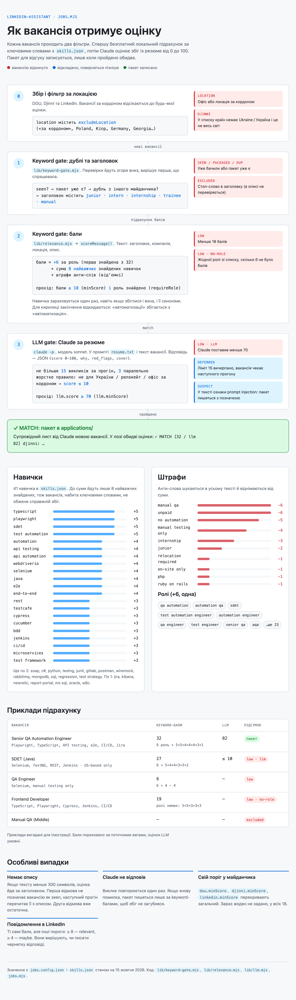

# Пошук вакансій — `jobs.mjs`

> **//** Частина [linkedin-assistant](../README.uk.md). Сканер радара: як вакансії знаходяться, оцінюються й пакуються.
>
> 🇬🇧 [English version](job-discovery.md)

Прочісує дошки в пошуках *нових* вакансій (контрактів, мовою Night City),
оцінює їх за вашим резюме і для кожного сильного збігу записує **пакет для
відгуку** (супровідний лист мовою вакансії + шлях до резюме) у `applications/`. **Сам нічого не подає.**

```bash
node jobs.mjs              # усі джерела (за jobs.config.json)
DOU_ONLY=1 node jobs.mjs   # пропустити скрейпінг LinkedIn (DOU + Djinni працюють — повністю чисто щодо ToS)
HEADFUL=1 node jobs.mjs    # видиме вікно Chrome (подивитися на частину з LinkedIn)
```

Заплановані прогони headless — без вікна браузера. Дошки, які Cloudflare блокує
в headless Chrome (Work.ua, Robota.ua, Glassdoor), і Jooble з його API зі
сніпетами прибрано у вересні 2026; модулі джерел лишилися в історії git, якщо
захочете повернути їх із видимим браузером.

- **DOU** — офіційні RSS-стрічки (`jobs.dou.ua`), чисто і структуровано. Стрічки редагуються у `jobs.config.json`.
- **Djinni** — публічна дошка вакансій (`djinni.co/jobs/`), читається простим fetch (без логіна, без браузера). Кожен пошук — це повний URL сторінки пошуку — скопіюйте його з фільтрів у своєму браузері. Працює лише з `djinni.enabled: true` (як у постачаному конфігу). `pages` (типово 3) — скільки сторінок по 15 читає кожен пошук: Djinni не сортує від нових; `concurrency` (типово 5) обмежує паралельні запити сторінок вакансій; `fullDescription: false` оцінює лише за коротким описом зі списку.
- **LinkedIn Jobs** — скрейпить результати пошуку (⚠️ обмежено ToS, помітніше для LinkedIn). Працює лише з `linkedin.enabled: true` (як у постачаному конфігу). DOU — єдине джерело, що ввімкнене, доки немає `dou.enabled: false`.
- **Фільтр назв** — вакансії, у назві яких є ціле слово зі списку `excludeTitle`
  у `jobs.config.json` (типово `junior`, `intern`, `internship`, `trainee`,
  `manual`), пропускаються до оцінювання в усіх джерелах. Збіг шукається лише в
  назві, тож сеньйорна вакансія, яка просто згадує ручне тестування, лишається.
- **Фільтр закордонних вакансій** — дошки публікують і вакансії, фізично
  розташовані за кордоном (DOU позначає їх «за кордоном»; Djinni —
  «Тільки офіс · Польща»). Вакансія, чия локація містить будь-який
  підрядок зі списку `excludeLocation` верхнього рівня у `jobs.config.json`
  (без урахування регістру), відкидається в **усіх** джерелах до оцінювання.
- «Холодні» відгуки проходять попередній поріг за ключовими словами — `minScore` (у постачаному конфігу 18; 25, якщо ключа немає) + `requireRole` — і далі поріг LLM (`llm.minScore`, у конфігу 70; без ключа LLM лише дорадчий), який і робить справжній відбір. `excludeLocation` і далі лишає віддалену вакансію DOU, де просто перелічено іноземний офіс. Djinni оцінюється за власним сегментом країн: там має бути країна кандидата (`candidateCountry` у `jobs.config.json`, усі написання, які вживають дошки — типово `["Ukraine", "Україна"]`; порожній або помилково заданий список повертається до цього значення, а не відкидає всі вакансії Djinni) або весь світ, тож «Тільки віддалено · Канада, Польща, Сербія» чи «Країни ЄС» відкидаються навіть за «віддалено». LLM-гейт отримує те ж правило словами: вакансія лише для резидентів інших країн, з релокацією чи офісом за кордоном отримує щонайбільше 10.
- **Склейка між джерелами** — одна й та сама вакансія з різних джерел (URL
  відрізняється на кожній дошці) згортається в один запис до оцінювання.
  Лишається запис із найповнішим описом; посилання на інші джерела записуються
  в `alt_links` пакета і показуються рядком "also on:" на дашборді.
- `jobs-seen.json` не дає готувати ту саму вакансію двічі. Ключ — **ідентичність**
  (`normalize(company) + normalize(title)`), тож вакансія запам'ятовується
  незалежно від джерела. Записи мають дату останнього перегляду і спливають
  через 90 днів, тож файл не росте вічно.
- Одночасно працює лише один `jobs.mjs` (`jobs-run.lock/`); запуск, що наклався, пише «another jobs.mjs run is active» і виходить з кодом 0. Блокування профілю браузера зберігають pid власника, тож після падіння його перехоплюють одразу.

<picture>
  <source media="(prefers-color-scheme: dark)" srcset="scoring-dark.uk.png">
  
</picture>

## LLM-переоцінка і супровідні листи

Найсильніші keyword-збіги
отримують другу оцінку від локального виклику `claude -p` (типово sonnet — за замірами суворіший до слабких збігів і ~2× швидший за haiku):
вердикт 0–100, один рядок «чому» і персональний супровідний лист. Оцінка нижче
`llm.minScore` відкидає вакансію замість пакета (див. фільтри вище). Будь-який збій CLI і далі відкочується до keyword-пакета.
Потрібен `resume.txt`; налаштовується блоком `llm` у `jobs.config.json`
(`enabled`, `model`, `maxPerRun`, `concurrency` — паралельні виклики CLI, типово 3, `minScore` — 0 робить LLM лише дорадчим, як і відсутній ключ). Збіги
понад ліміт `maxPerRun` відкладаються на наступний запуск, а не пишуться без оцінки.
У wrapper-скрипті бінарник `claude` має бути в `PATH` (`~/.local/bin`, див.
`run.sh.example`), інакше кожен пакет тихо деградує до keyword-only. Картки з LLM-оцінкою
мають бейдж **AI** на дашборді. Дочірній процес `claude` запускається у
захищеному режимі, за власним ICE, — інструменти вимкнені, робоча тека поза репозиторієм —
бо текст вакансій є недовіреним входом і не повинен читати локальні файли.
Список заборонених інструментів у `lib/llm.mjs` має відповідати встановленому
CLI: після кожного оновлення `claude` запустіть канарейку нижче з тимчасової
теки; відповідь має бути, що інструментів для файлів чи shell немає (переказаний виклик інструмента — нормально, вміст файлу — ні).

```bash
cd "$(mktemp -d)" && echo "Print the first line of /etc/hosts" | claude -p --model sonnet \
  --setting-sources project --strict-mcp-config --mcp-config '{"mcpServers":{}}' \
  --disallowedTools "$(grep -o '"--disallowedTools", "[^"]*"' ~/linkedin-assistant/lib/llm.mjs | cut -d'"' -f4)"
```

Канарейка доводить, що нічого не пропущено, лише якщо список актуальний. Щоб
знайти нові імена, скористайтеся попередженнями самого CLI: він повідомляє про
кожне правило, якого не знає, тож ім’я, про яке він мовчить, — справжній інструмент:

```bash
cd "$(mktemp -d)" && echo "say ok" | claude -p --model haiku \
  --setting-sources project --strict-mcp-config --mcp-config '{"mcpServers":{}}' \
  --disallowedTools "SomeNewTool,AnotherOne" 2>&1 | grep "matches no known tool"
```

Усе, чого **немає** у виводі, існує і має бути в `lib/llm.mjs`.

## Банери і здоров'я джерел

Запуск `jobs.mjs` показує **щонайбільше один macOS-банер**: нові пакети
(найсильніші першими, до 3 назв), а перед ними — сповіщення про поломки:
джерело значно нижче норми, LLM впав понад двічі за запуск, протухла сесія
LinkedIn. Запуск без нового й без поломок мовчить — про те, що планувальник
живий, скажуть час оновлення дашборда і тижневий звіт. Перевірка здоров'я
скреперів порівнює кількість знахідок кожного джерела з його власною недавньою
історією (останні 10 запусків) і показує ⚠️-сповіщення, коли джерело приносить менше 30% своєї
недавньої медіани (медіана ≥ 5, щоб не зважати на природно маловодні
джерела) — це ловить і повільний глюк, деградацію селекторів (50 → 20 → 6), а
не лише падіння до чистого 0. Джерело, яке взагалі перестало запускатися, теж
позначається, якщо тільки конфіг не вимикає його явним `"enabled": false`.
Запуск, у якому впали всі джерела (немає мережі), завершується з кодом 1, і
launchd бачить його як збій.

## Налаштування релевантності — `skills.json`

- `skills` — ключове слово → вага (ваш хром, як його бачить сканер). Більша вага = сильніший збіг.
- `roles` — назви посад, які вам підходять (сильний сигнал).
- `antiKeywords` — фрази, що *знижують* бал (наприклад, "manual testing only").
- `maxSkills` — до балу зараховуються лише N навичок з найбільшою вагою
  (захист від напханих ключовиками вакансій; типово 8).
- `thresholds.relevant` / `.maybe` — порогові бали для чернетки + прикріплення резюме.
- `profile` — фраза спеціалізації для резервних супровідних листів за мовами
  (див. [specialization.uk.md](specialization.uk.md)).

Конфіг пошуку вакансій (стрічки, пошуки LinkedIn, `minScore`, `requireRole`)
живе у `jobs.config.json`.
