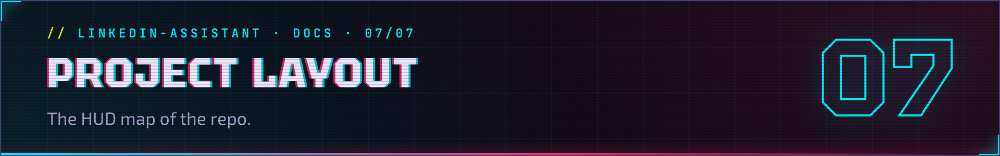

<h1></h1>

> **//** Part of [linkedin-assistant](../README.md). The HUD map of the repo: which file does what.
>
> 🇺🇦 [Українською](project-layout.uk.md)

```
~/linkedin-assistant/
├── check.mjs          inbox → reply drafts
├── jobs.mjs           job discovery → application packages
├── login.mjs          one-time login (LinkedIn by default, `djinni` argument)
├── djinni-check.mjs   Djinni inbox unread count → djinni-notify-state.json
├── dashboard.mjs      HTML dashboard generator
├── state-server.mjs   local HTTP server (127.0.0.1:7777) for job-state persistence
├── report.mjs         weekly digest (Monday launchd job, or run by hand)
├── make-skills.mjs    generate skills.json from resume.txt (one-time setup)
├── telegram-setup.mjs one-time setup of the optional Telegram alerts → telegram.json
├── closed-check.mjs   mark DOU/Djinni/LinkedIn vacancies the board reports inactive as Closed (daily launchd job)
├── open-dashboard.sh  Dock-click helper: regenerate → open browser
├── lib/               logic (scoring, dedup, templates, DOU/Djinni/Himalayas/Telegram/LinkedIn sources)
├── docs/              these pages, their headers/ bars + README images (HTML sources and render.mjs in docs/src/)
├── test/              unit + black-box CLI tests (`npm test`, no browser)
├── e2e/               dashboard end-to-end tests in a real browser (`npm run test:e2e`)
├── skills.json        skill profile + weights
├── jobs.config.json   what and where to search
├── job-state.json     per-card state (status, notes, last-visit) — gitignored
├── drafts/            reply drafts
├── applications/      application packages + index.html
└── Jobs.app           Dock shortcut 💼
```

## What's where

| File                  | Purpose                                                   |
|-----------------------|-----------------------------------------------------------|
| `login.mjs`           | One-time manual login (LinkedIn default, `node login.mjs djinni`); persists session. |
| `check.mjs`           | Read unread → score → draft. Never sends.                 |
| `djinni-check.mjs`    | Count unread Djinni inbox threads. Count-only, never opens threads. |
| `jobs.mjs`            | Discover vacancies → application packages. Never submits. |
| `dashboard.mjs`       | Build the HTML dashboard (Viewed / Closed, notes, filters); inlines `lib/dashboard.css` and the client script. |
| `state-server.mjs`    | Local HTTP server at 127.0.0.1:7777; persists job state to `job-state.json`. |
| `report.mjs`          | Weekly digest: runs, packages per source, LLM verdicts, source yield. |
| `closed-check.mjs`    | Probe New/Viewed DOU, Djinni and LinkedIn urls; mark board-inactive vacancies Closed. |
| `open-dashboard.sh`   | Dock-click helper: regenerate dashboard, open browser. |
| `telegram-setup.mjs`  | One-time setup of the optional Telegram alerts: finds your chat, writes `telegram.json`. |
| `lib/telegram.mjs`    | Telegram copy of the alerts: message format, `telegram-outbox/` queue, sender. |
| `lib/jobs-config.mjs` | `jobs.config.json` → normalized flags, lists, knobs; reports misspelt keys. |
| `lib/llm-gate.mjs`    | The LLM gate: verdicts in parallel, packages in score order, deferral on failure. |
| `lib/relevance.mjs`   | Local scoring (no API key, nothing leaves the machine).   |
| `lib/dedup.mjs`       | Cross-source de-dup: identity key + collapse duplicates.  |
| `lib/draft.mjs`       | Builds the reply-draft markdown.                          |
| `lib/application.mjs` | Builds the application-package markdown.                  |
| `skills.json`         | Your skill profile + thresholds. Edit freely.             |
| `resume.txt`          | Your full resume as plain text (scoring, LLM, letters).   |
| `drafts/`             | Output — review and send these manually.                  |
| `seen.json`           | Tracks processed messages (thread + newest message), so a follow-up in a known thread is processed again. |
| `jobs-seen.json`      | Tracks processed vacancies by identity (no duplicate packages, across sources). |

## Tests

```bash
npm test                          # unit + black-box CLI tests (node --test, no browser)
npm run lint                      # oxlint
npx playwright install chromium   # once per machine, for the e2e suite
npm run test:e2e                  # dashboard end-to-end tests (Playwright, Chromium)
```

`e2e/` drives the dashboard in a real browser: the New / Viewed tabs, source
chips, status buttons, notes, Copy letter, the Dark toggle, the offline badge,
the NEW ribbon and the empty / no-match states. Its global setup builds the page with the real
`dashboard.mjs` from fixture packages (`e2e/support/jobs.mjs`) in a temp dir,
and every test gets its own `createServer` instance on a random loopback port
with a fresh `job-state.json`; the browser can reach only that server. The
suite never talks to the live `:7777` server
and never reads or writes your `job-state.json` or `applications/`. It lives
outside `test/` because bare `node --test` runs every file there. CI runs it
in its own `e2e` job (Ubuntu, Node 20 and 24).
